<a href="#selected-work"></a>

  &nbsp;
  &nbsp;
  

 

<picture>
  <source media="(prefers-color-scheme: light)" srcset="assets/h-about-light.svg"/>
  
</picture>

I'm a Computer Engineering undergrad at **Thapar Institute of Engineering & Technology**, working where machine learning meets product. I like problems with real people on the other end: a parent who lives alone, a payment that looks wrong, a child who doesn't know their rights yet.

Most of my work is built with my hackathon team and taken from idea to a shipped demo: regression and gradient-boosted models, risk-scoring APIs, simulations, and full-stack web and mobile apps around them. Outside the editor I do case competitions and keep my DSA sharp in C++.

**Where I'm headed:** Product Management + AI.

 

<picture>
  <source media="(prefers-color-scheme: light)" srcset="assets/h-work-light.svg"/>
  
</picture>

  <a href="https://github.com/shefali1702/AQI-Prediction-Using-AI-ML"></a>
  <a href="https://github.com/shefali1702/BIOS-Transaction-Authentication"></a>

  <a href="https://github.com/shefali1702/khairiyat"></a>
  <a href="https://github.com/shefali1702/saksham"></a>

  <a href="https://github.com/shefali1702/Cascade"></a>
  <a href="https://github.com/shefali1702/parchhai"></a>

  <a href="https://github.com/shefali1702/ThaliBento"></a>

Also &nbsp;·&nbsp; <a href="https://github.com/shefali1702/ML_Git_Lab">ML_Git_Lab</a> — Git workflows for ML &nbsp;·&nbsp; <a href="https://github.com/shefali1702/enterprising-web-applications-assignment-solutions">Enterprise Web Apps in Java</a>

 

<picture>
  <source media="(prefers-color-scheme: light)" srcset="assets/h-toolkit-light.svg"/>
  
</picture>


  

<picture>
  <source media="(prefers-color-scheme: light)" srcset="assets/h-signal-light.svg"/>
  
</picture>

  
  

 

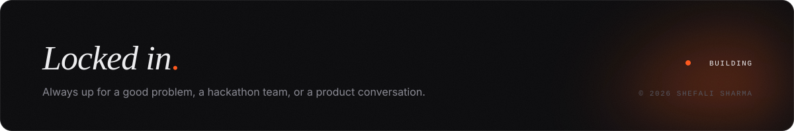
